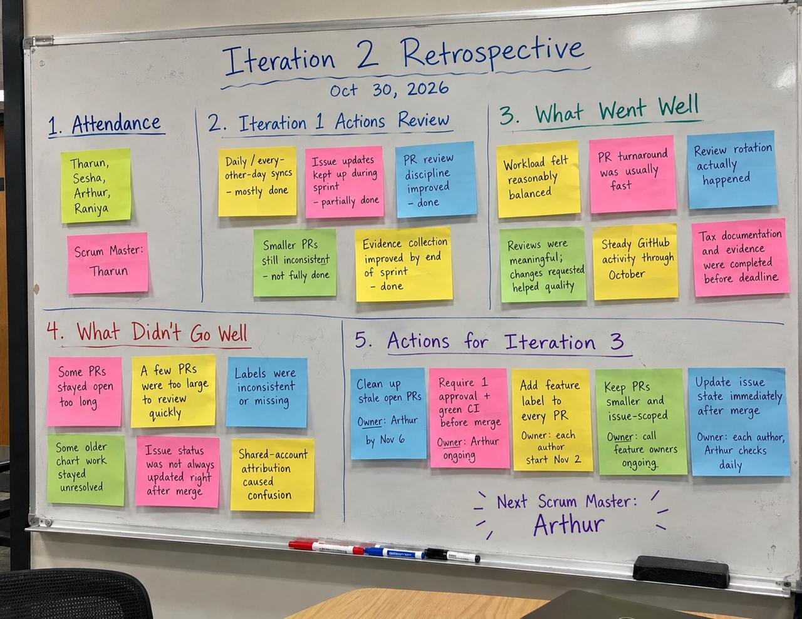

# Iteration 2 Report — Ghostfolio Extension

**Team:** Sesha Siva Sankar (Risk), Tharun Swaminathan (Tax, Scrum Master), Arthur Elly Lim (Charts), Raniya Shaikh (Architecture / QA / Dashboard)
**Sprint window:** Fri Oct 2 – Sun Nov 1, 2026
**Repository:** https://github.com/Ghostfolio-Group-1/ghostfolio-software-engineering-project-g1

> Rule for every section: each implementation claim must be supported by a merged PR, closed issue, CI/test record, or file under `project-docs/iteration-2/evidence/`. Open/unmerged work is identified separately rather than reported as completed. Repository data below reflects the final Oct 31, 22:51 UTC issue/PR cleanup pass (9 issues closed, 10 PRs closed as superseded/stale, 1 reviewed and approved); it is the final refresh before submission.

---

## Executive Summary

Iteration 2 moved the Ghostfolio extension from design specifications into a working backend increment.

By the latest Oct 31 repository refresh, the team had merged **68 pull requests** into `main` during the Iteration 2 period represented in this report:

- Raniya: 22
- Tharun: 20
- Sesha: 16
- Arthur / `Error404IsFound`: 10

The Risk and Tax backends delivered their primary planned Iteration 2 functionality. Charts delivered the shared time-range and chart-series pipeline before the feature freeze, while the drawdown endpoint merged on Oct 30 after the freeze through [PR #167](https://github.com/Ghostfolio-Group-1/ghostfolio-software-engineering-project-g1/pull/167). Charts as-built documentation then merged through [PR #170](https://github.com/Ghostfolio-Group-1/ghostfolio-software-engineering-project-g1/pull/170). Benchmark comparison and return comparison remain unmerged at this report snapshot.

The unified dashboard endpoint, `GET /api/v1/dashboard/overview`, aggregates Risk, Tax and Charts and can mark an individual source unavailable without failing the entire overview.

Quality controls improved substantially during Iteration 2. Branch protection requires the three CI checks introduced through [PR #87](https://github.com/Ghostfolio-Group-1/ghostfolio-software-engineering-project-g1/pull/87):

- Lint and format
- Unit tests
- Build

Shared integration fixtures were introduced through [PR #116](https://github.com/Ghostfolio-Group-1/ghostfolio-software-engineering-project-g1/pull/116), and end-to-end HTTP coverage was added across the feature endpoints.

The final integration pass before the Oct 28 feature freeze ran on application baseline `25bea2186` and recorded:

```text
E2E suites: 4 / 4 passed
E2E tests: 47 / 47 passed

Full API suite:
93 suites passed
1 suite skipped

641 tests passed
1 test skipped

API build:
passed
```

Evidence: [Integration Pass #2](../evidence/integration-pass-2-2026-10-28.md).

The primary remaining gaps are:

- benchmark comparison ([#160](https://github.com/Ghostfolio-Group-1/ghostfolio-software-engineering-project-g1/pull/160)) and return-comparison ([#105](https://github.com/Ghostfolio-Group-1/ghostfolio-software-engineering-project-g1/pull/105)) Charts work, both carried into Iteration 3;
- Risk catch-all error-envelope consistency;
- React dashboard/frontend work for Iteration 3;
- final architecture documentation PR [#162](https://github.com/Ghostfolio-Group-1/ghostfolio-software-engineering-project-g1/pull/162), merged Oct 31 at 23:00 UTC;
- PR [#153](https://github.com/Ghostfolio-Group-1/ghostfolio-software-engineering-project-g1/pull/153) (approved, CI green, mergeable) and issue [#158](https://github.com/Ghostfolio-Group-1/ghostfolio-software-engineering-project-g1/issues/158) it closes, both pending a maintainer merge (blocked locally, see section 4.1);
- incomplete detailed Scrum attendance evidence.

The Oct 31 stale/open issue and PR cleanup itself is complete: see section 4 for the full before/after counts.

---

## 1. Project Backlog

_Owner: Raniya (table); each member verifies their own feature row._

| Feature                               | Owner  | Planned for Iteration 2                                                                                                                                                                         | Status at latest Oct 30 refresh                                                                                                                                                                                                    | Evidence                                                                                                                                                                                                                                                                                                                                                                                                                                                                                                                                                                                                                                                                                                                                                                                                                                                                                                                                                                                                                                                                                                                                                                                                                                                                                                                                                                                                                                                                                                                                                                                                                                                                                                                                                                                                                                                                                                                                                                                                                                                                                                                                                                                                                                         |
| ------------------------------------- | ------ | ----------------------------------------------------------------------------------------------------------------------------------------------------------------------------------------------- | ---------------------------------------------------------------------------------------------------------------------------------------------------------------------------------------------------------------------------------- | ------------------------------------------------------------------------------------------------------------------------------------------------------------------------------------------------------------------------------------------------------------------------------------------------------------------------------------------------------------------------------------------------------------------------------------------------------------------------------------------------------------------------------------------------------------------------------------------------------------------------------------------------------------------------------------------------------------------------------------------------------------------------------------------------------------------------------------------------------------------------------------------------------------------------------------------------------------------------------------------------------------------------------------------------------------------------------------------------------------------------------------------------------------------------------------------------------------------------------------------------------------------------------------------------------------------------------------------------------------------------------------------------------------------------------------------------------------------------------------------------------------------------------------------------------------------------------------------------------------------------------------------------------------------------------------------------------------------------------------------------------------------------------------------------------------------------------------------------------------------------------------------------------------------------------------------------------------------------------------------------------------------------------------------------------------------------------------------------------------------------------------------------------------------------------------------------------------------------------------------------ |
| Portfolio Risk                        | Sesha  | Concentration rules, exposure calculators, volatility, cash/target-deviation rules, health score, warning thresholds, what-if analysis, risk API                                                | Major planned backend functionality delivered. Known gap: no catch-all `RISK_*` error envelope for unexpected failures.                                                                                                            | [#51](https://github.com/Ghostfolio-Group-1/ghostfolio-software-engineering-project-g1/pull/51), [#71](https://github.com/Ghostfolio-Group-1/ghostfolio-software-engineering-project-g1/pull/71), [#77](https://github.com/Ghostfolio-Group-1/ghostfolio-software-engineering-project-g1/pull/77), [#88](https://github.com/Ghostfolio-Group-1/ghostfolio-software-engineering-project-g1/pull/88), [#91](https://github.com/Ghostfolio-Group-1/ghostfolio-software-engineering-project-g1/pull/91), [#95](https://github.com/Ghostfolio-Group-1/ghostfolio-software-engineering-project-g1/pull/95), [#102](https://github.com/Ghostfolio-Group-1/ghostfolio-software-engineering-project-g1/pull/102), [#108](https://github.com/Ghostfolio-Group-1/ghostfolio-software-engineering-project-g1/pull/108), [#113](https://github.com/Ghostfolio-Group-1/ghostfolio-software-engineering-project-g1/pull/113), [#119](https://github.com/Ghostfolio-Group-1/ghostfolio-software-engineering-project-g1/pull/119), [#125](https://github.com/Ghostfolio-Group-1/ghostfolio-software-engineering-project-g1/pull/125), [#138](https://github.com/Ghostfolio-Group-1/ghostfolio-software-engineering-project-g1/pull/138), [#144](https://github.com/Ghostfolio-Group-1/ghostfolio-software-engineering-project-g1/pull/144)                                                                                                                                                                                                                                                                                                                                                                                                                                                                                                                                                                                                                                                                                                                                                                                                                                                                                                                        |
| Tax Metrics                           | Tharun | Withholding tax, dividends, FIFO lots and gains, average cost, method switch, tax lots, tax-relevant filtering, yearly summary, CSV/PDF export                                                  | Planned Iteration 2 backend roadmap delivered.                                                                                                                                                                                     | [#72](https://github.com/Ghostfolio-Group-1/ghostfolio-software-engineering-project-g1/pull/72), [#80](https://github.com/Ghostfolio-Group-1/ghostfolio-software-engineering-project-g1/pull/80), [#86](https://github.com/Ghostfolio-Group-1/ghostfolio-software-engineering-project-g1/pull/86), [#92](https://github.com/Ghostfolio-Group-1/ghostfolio-software-engineering-project-g1/pull/92), [#98](https://github.com/Ghostfolio-Group-1/ghostfolio-software-engineering-project-g1/pull/98), [#104](https://github.com/Ghostfolio-Group-1/ghostfolio-software-engineering-project-g1/pull/104), [#109](https://github.com/Ghostfolio-Group-1/ghostfolio-software-engineering-project-g1/pull/109), [#117](https://github.com/Ghostfolio-Group-1/ghostfolio-software-engineering-project-g1/pull/117), [#120](https://github.com/Ghostfolio-Group-1/ghostfolio-software-engineering-project-g1/pull/120), [#126](https://github.com/Ghostfolio-Group-1/ghostfolio-software-engineering-project-g1/pull/126), [#132](https://github.com/Ghostfolio-Group-1/ghostfolio-software-engineering-project-g1/pull/132), [#139](https://github.com/Ghostfolio-Group-1/ghostfolio-software-engineering-project-g1/pull/139), [#147](https://github.com/Ghostfolio-Group-1/ghostfolio-software-engineering-project-g1/pull/147), [#148](https://github.com/Ghostfolio-Group-1/ghostfolio-software-engineering-project-g1/pull/148), [#152](https://github.com/Ghostfolio-Group-1/ghostfolio-software-engineering-project-g1/pull/152), [#159](https://github.com/Ghostfolio-Group-1/ghostfolio-software-engineering-project-g1/pull/159), [#164](https://github.com/Ghostfolio-Group-1/ghostfolio-software-engineering-project-g1/pull/164), [#169](https://github.com/Ghostfolio-Group-1/ghostfolio-software-engineering-project-g1/pull/169)                                                                                                                                                                                                                                                                                                                                                                                                       |
| Performance Charts                    | Arthur | Time-range resolver, value/invested/cash series, return comparison, benchmark comparison, drawdown                                                                                              | Time-range resolver and `GET /charts/series` delivered before freeze. `GET /charts/drawdown` merged Oct 30 after freeze. Charts as-built documentation also merged Oct 30. Return comparison and benchmark comparison remain open. | [#76](https://github.com/Ghostfolio-Group-1/ghostfolio-software-engineering-project-g1/pull/76), [#83](https://github.com/Ghostfolio-Group-1/ghostfolio-software-engineering-project-g1/pull/83), [#90](https://github.com/Ghostfolio-Group-1/ghostfolio-software-engineering-project-g1/pull/90), [#101](https://github.com/Ghostfolio-Group-1/ghostfolio-software-engineering-project-g1/pull/101), [#167](https://github.com/Ghostfolio-Group-1/ghostfolio-software-engineering-project-g1/pull/167), [#170](https://github.com/Ghostfolio-Group-1/ghostfolio-software-engineering-project-g1/pull/170)                                                                                                                                                                                                                                                                                                                                                                                                                                                                                                                                                                                                                                                                                                                                                                                                                                                                                                                                                                                                                                                                                                                                                                                                                                                                                                                                                                                                                                                                                                                                                                                                                                       |
| Unified Dashboard / Architecture / QA | Raniya | API/module scaffolding, API conventions, CI, data-layer wiring, React component library, fixtures, integration tests, dashboard aggregation and endpoint, integration passes, architecture docs | Dashboard endpoint, CI, shared integration fixtures and two integration passes delivered. Standalone as-built architecture documentation merged in PR #162 on Oct 31.                                                              | [#49](https://github.com/Ghostfolio-Group-1/ghostfolio-software-engineering-project-g1/pull/49), [#61](https://github.com/Ghostfolio-Group-1/ghostfolio-software-engineering-project-g1/pull/61), [#74](https://github.com/Ghostfolio-Group-1/ghostfolio-software-engineering-project-g1/pull/74), [#75](https://github.com/Ghostfolio-Group-1/ghostfolio-software-engineering-project-g1/pull/75), [#82](https://github.com/Ghostfolio-Group-1/ghostfolio-software-engineering-project-g1/pull/82), [#87](https://github.com/Ghostfolio-Group-1/ghostfolio-software-engineering-project-g1/pull/87), [#94](https://github.com/Ghostfolio-Group-1/ghostfolio-software-engineering-project-g1/pull/94), [#99](https://github.com/Ghostfolio-Group-1/ghostfolio-software-engineering-project-g1/pull/99), [#107](https://github.com/Ghostfolio-Group-1/ghostfolio-software-engineering-project-g1/pull/107), [#111](https://github.com/Ghostfolio-Group-1/ghostfolio-software-engineering-project-g1/pull/111), [#116](https://github.com/Ghostfolio-Group-1/ghostfolio-software-engineering-project-g1/pull/116), [#122](https://github.com/Ghostfolio-Group-1/ghostfolio-software-engineering-project-g1/pull/122), [#129](https://github.com/Ghostfolio-Group-1/ghostfolio-software-engineering-project-g1/pull/129), [#135](https://github.com/Ghostfolio-Group-1/ghostfolio-software-engineering-project-g1/pull/135), [#136](https://github.com/Ghostfolio-Group-1/ghostfolio-software-engineering-project-g1/pull/136), [#141](https://github.com/Ghostfolio-Group-1/ghostfolio-software-engineering-project-g1/pull/141), [#146](https://github.com/Ghostfolio-Group-1/ghostfolio-software-engineering-project-g1/pull/146), [#150](https://github.com/Ghostfolio-Group-1/ghostfolio-software-engineering-project-g1/pull/150), [#157](https://github.com/Ghostfolio-Group-1/ghostfolio-software-engineering-project-g1/pull/157), [#166](https://github.com/Ghostfolio-Group-1/ghostfolio-software-engineering-project-g1/pull/166), [#172](https://github.com/Ghostfolio-Group-1/ghostfolio-software-engineering-project-g1/pull/172), [#175](https://github.com/Ghostfolio-Group-1/ghostfolio-software-engineering-project-g1/pull/175) |

---

## 2. Sprint Backlog

_Owner: Raniya (tables); each member verifies their own rows._

### 2.1 Daily Tasks / Merged PRs

| Merged     | Member | Task                                                    | PR                                                                                                | Issue                                                                                               |
| ---------- | ------ | ------------------------------------------------------- | ------------------------------------------------------------------------------------------------- | --------------------------------------------------------------------------------------------------- |
| 2026-10-02 | Sesha  | Risk issue-plan update for sprint-planning day          | [#44](https://github.com/Ghostfolio-Group-1/ghostfolio-software-engineering-project-g1/pull/44)   | —                                                                                                   |
| 2026-10-03 | Raniya | PR template, CODEOWNERS and daily PR fallback workflow  | [#49](https://github.com/Ghostfolio-Group-1/ghostfolio-software-engineering-project-g1/pull/49)   | —                                                                                                   |
| 2026-10-03 | Tharun | Close Tax DR-1–3 and add Scrum notes                    | [#48](https://github.com/Ghostfolio-Group-1/ghostfolio-software-engineering-project-g1/pull/48)   | [#45](https://github.com/Ghostfolio-Group-1/ghostfolio-software-engineering-project-g1/issues/45)   |
| 2026-10-05 | Sesha  | Single-stock concentration rule                         | [#51](https://github.com/Ghostfolio-Group-1/ghostfolio-software-engineering-project-g1/pull/51)   | [#30](https://github.com/Ghostfolio-Group-1/ghostfolio-software-engineering-project-g1/issues/30)   |
| 2026-10-05 | Raniya | Empty Risk, Tax and Charts API module skeletons         | [#61](https://github.com/Ghostfolio-Group-1/ghostfolio-software-engineering-project-g1/pull/61)   | [#60](https://github.com/Ghostfolio-Group-1/ghostfolio-software-engineering-project-g1/issues/60)   |
| 2026-10-06 | Tharun | Close Tax DR-4–6 and file remaining backlog             | [#59](https://github.com/Ghostfolio-Group-1/ghostfolio-software-engineering-project-g1/pull/59)   | [#52](https://github.com/Ghostfolio-Group-1/ghostfolio-software-engineering-project-g1/issues/52)   |
| 2026-10-06 | Sesha  | Sector and country concentration rules                  | [#71](https://github.com/Ghostfolio-Group-1/ghostfolio-software-engineering-project-g1/pull/71)   | [#31](https://github.com/Ghostfolio-Group-1/ghostfolio-software-engineering-project-g1/issues/31)   |
| 2026-10-06 | Raniya | Shared API convention types                             | [#74](https://github.com/Ghostfolio-Group-1/ghostfolio-software-engineering-project-g1/pull/74)   | [#73](https://github.com/Ghostfolio-Group-1/ghostfolio-software-engineering-project-g1/issues/73)   |
| 2026-10-07 | Tharun | Nullable `withholdingTax` in Order and DTOs             | [#72](https://github.com/Ghostfolio-Group-1/ghostfolio-software-engineering-project-g1/pull/72)   | [#46](https://github.com/Ghostfolio-Group-1/ghostfolio-software-engineering-project-g1/issues/46)   |
| 2026-10-07 | Raniya | React component library scaffold                        | [#75](https://github.com/Ghostfolio-Group-1/ghostfolio-software-engineering-project-g1/pull/75)   | —                                                                                                   |
| 2026-10-07 | Tharun | Validate withholding-tax persistence                    | [#80](https://github.com/Ghostfolio-Group-1/ghostfolio-software-engineering-project-g1/pull/80)   | [#79](https://github.com/Ghostfolio-Group-1/ghostfolio-software-engineering-project-g1/issues/79)   |
| 2026-10-07 | Arthur | Shared chart time-range resolver                        | [#76](https://github.com/Ghostfolio-Group-1/ghostfolio-software-engineering-project-g1/pull/76)   | —                                                                                                   |
| 2026-10-07 | Sesha  | Export hotfix for `withholdingTax` mapping              | [#78](https://github.com/Ghostfolio-Group-1/ghostfolio-software-engineering-project-g1/pull/78)   | —                                                                                                   |
| 2026-10-08 | Arthur | Map performance history to `ChartSeriesResponse`        | [#83](https://github.com/Ghostfolio-Group-1/ghostfolio-software-engineering-project-g1/pull/83)   | —                                                                                                   |
| 2026-10-08 | Raniya | Split CI into lint, unit-test and build jobs            | [#87](https://github.com/Ghostfolio-Group-1/ghostfolio-software-engineering-project-g1/pull/87)   | [#85](https://github.com/Ghostfolio-Group-1/ghostfolio-software-engineering-project-g1/issues/85)   |
| 2026-10-09 | Sesha  | Currency and asset-class exposure calculators           | [#77](https://github.com/Ghostfolio-Group-1/ghostfolio-software-engineering-project-g1/pull/77)   | [#32](https://github.com/Ghostfolio-Group-1/ghostfolio-software-engineering-project-g1/issues/32)   |
| 2026-10-09 | Raniya | React Card/Button/theme and test-claim correction       | [#82](https://github.com/Ghostfolio-Group-1/ghostfolio-software-engineering-project-g1/pull/82)   | [#81](https://github.com/Ghostfolio-Group-1/ghostfolio-software-engineering-project-g1/issues/81)   |
| 2026-10-09 | Sesha  | `ExposureService` RiskSummary aggregation               | [#88](https://github.com/Ghostfolio-Group-1/ghostfolio-software-engineering-project-g1/pull/88)   | [#33](https://github.com/Ghostfolio-Group-1/ghostfolio-software-engineering-project-g1/issues/33)   |
| 2026-10-09 | Sesha  | Volatility input model                                  | [#91](https://github.com/Ghostfolio-Group-1/ghostfolio-software-engineering-project-g1/pull/91)   | [#34](https://github.com/Ghostfolio-Group-1/ghostfolio-software-engineering-project-g1/issues/34)   |
| 2026-10-09 | Tharun | FIFO ordering and BUY-derived TaxLots                   | [#92](https://github.com/Ghostfolio-Group-1/ghostfolio-software-engineering-project-g1/pull/92)   | [#47](https://github.com/Ghostfolio-Group-1/ghostfolio-software-engineering-project-g1/issues/47)   |
| 2026-10-09 | Raniya | Risk API shared data-layer wiring and schema tests      | [#94](https://github.com/Ghostfolio-Group-1/ghostfolio-software-engineering-project-g1/pull/94)   | [#93](https://github.com/Ghostfolio-Group-1/ghostfolio-software-engineering-project-g1/issues/93)   |
| 2026-10-10 | Arthur | Charts edge cases                                       | [#90](https://github.com/Ghostfolio-Group-1/ghostfolio-software-engineering-project-g1/pull/90)   | —                                                                                                   |
| 2026-10-13 | Tharun | FIFO partial-sell lot consumption                       | [#98](https://github.com/Ghostfolio-Group-1/ghostfolio-software-engineering-project-g1/pull/98)   | [#96](https://github.com/Ghostfolio-Group-1/ghostfolio-software-engineering-project-g1/issues/96)   |
| 2026-10-13 | Raniya | Tax API shared data-layer wiring                        | [#99](https://github.com/Ghostfolio-Group-1/ghostfolio-software-engineering-project-g1/pull/99)   | [#97](https://github.com/Ghostfolio-Group-1/ghostfolio-software-engineering-project-g1/issues/97)   |
| 2026-10-13 | Arthur | Invested-capital and cash sampling                      | [#101](https://github.com/Ghostfolio-Group-1/ghostfolio-software-engineering-project-g1/pull/101) | —                                                                                                   |
| 2026-10-13 | Sesha  | Cash-allocation rule                                    | [#102](https://github.com/Ghostfolio-Group-1/ghostfolio-software-engineering-project-g1/pull/102) | [#36](https://github.com/Ghostfolio-Group-1/ghostfolio-software-engineering-project-g1/issues/36)   |
| 2026-10-14 | Tharun | FIFO realized gains                                     | [#104](https://github.com/Ghostfolio-Group-1/ghostfolio-software-engineering-project-g1/pull/104) | [#103](https://github.com/Ghostfolio-Group-1/ghostfolio-software-engineering-project-g1/issues/103) |
| 2026-10-14 | Raniya | Charts API shared data layer and chart-wrapper scaffold | [#107](https://github.com/Ghostfolio-Group-1/ghostfolio-software-engineering-project-g1/pull/107) | [#106](https://github.com/Ghostfolio-Group-1/ghostfolio-software-engineering-project-g1/issues/106) |
| 2026-10-14 | Raniya | React dashboard-card component                          | [#111](https://github.com/Ghostfolio-Group-1/ghostfolio-software-engineering-project-g1/pull/111) | —                                                                                                   |
| 2026-10-15 | Tharun | FIFO edge cases                                         | [#109](https://github.com/Ghostfolio-Group-1/ghostfolio-software-engineering-project-g1/pull/109) | [#100](https://github.com/Ghostfolio-Group-1/ghostfolio-software-engineering-project-g1/issues/100) |
| 2026-10-15 | Arthur | FIFO remaining-share cost-basis test/support            | [#112](https://github.com/Ghostfolio-Group-1/ghostfolio-software-engineering-project-g1/pull/112) | —                                                                                                   |
| 2026-10-16 | Tharun | FIFO realized-gains API                                 | [#117](https://github.com/Ghostfolio-Group-1/ghostfolio-software-engineering-project-g1/pull/117) | [#114](https://github.com/Ghostfolio-Group-1/ghostfolio-software-engineering-project-g1/issues/114) |
| 2026-10-16 | Arthur | Open FIFO lots by remaining shares                      | [#118](https://github.com/Ghostfolio-Group-1/ghostfolio-software-engineering-project-g1/pull/118) | —                                                                                                   |
| 2026-10-16 | Sesha  | WarningThreshold model                                  | [#119](https://github.com/Ghostfolio-Group-1/ghostfolio-software-engineering-project-g1/pull/119) | [#39](https://github.com/Ghostfolio-Group-1/ghostfolio-software-engineering-project-g1/issues/39)   |
| 2026-10-16 | Sesha  | Volatility rule                                         | [#95](https://github.com/Ghostfolio-Group-1/ghostfolio-software-engineering-project-g1/pull/95)   | [#35](https://github.com/Ghostfolio-Group-1/ghostfolio-software-engineering-project-g1/issues/35)   |
| 2026-10-16 | Sesha  | Target-deviation rule                                   | [#108](https://github.com/Ghostfolio-Group-1/ghostfolio-software-engineering-project-g1/pull/108) | [#37](https://github.com/Ghostfolio-Group-1/ghostfolio-software-engineering-project-g1/issues/37)   |
| 2026-10-16 | Sesha  | HealthScore calculator                                  | [#113](https://github.com/Ghostfolio-Group-1/ghostfolio-software-engineering-project-g1/pull/113) | [#38](https://github.com/Ghostfolio-Group-1/ghostfolio-software-engineering-project-g1/issues/38)   |
| 2026-10-17 | Raniya | Shared integration fixtures                             | [#116](https://github.com/Ghostfolio-Group-1/ghostfolio-software-engineering-project-g1/pull/116) | [#115](https://github.com/Ghostfolio-Group-1/ghostfolio-software-engineering-project-g1/issues/115) |
| 2026-10-17 | Tharun | Average-cost running pool                               | [#120](https://github.com/Ghostfolio-Group-1/ghostfolio-software-engineering-project-g1/pull/120) | [#53](https://github.com/Ghostfolio-Group-1/ghostfolio-software-engineering-project-g1/issues/53)   |
| 2026-10-19 | Raniya | E2E scaffold and first Risk endpoint E2E                | [#122](https://github.com/Ghostfolio-Group-1/ghostfolio-software-engineering-project-g1/pull/122) | [#121](https://github.com/Ghostfolio-Group-1/ghostfolio-software-engineering-project-g1/issues/121) |
| 2026-10-19 | Tharun | Average-cost realized gains                             | [#126](https://github.com/Ghostfolio-Group-1/ghostfolio-software-engineering-project-g1/pull/126) | [#124](https://github.com/Ghostfolio-Group-1/ghostfolio-software-engineering-project-g1/issues/124) |
| 2026-10-19 | Raniya | Tax realized-gains E2E                                  | [#129](https://github.com/Ghostfolio-Group-1/ghostfolio-software-engineering-project-g1/pull/129) | [#128](https://github.com/Ghostfolio-Group-1/ghostfolio-software-engineering-project-g1/issues/128) |
| 2026-10-21 | Raniya | Charts-series E2E                                       | [#135](https://github.com/Ghostfolio-Group-1/ghostfolio-software-engineering-project-g1/pull/135) | [#133](https://github.com/Ghostfolio-Group-1/ghostfolio-software-engineering-project-g1/issues/133) |
| 2026-10-21 | Sesha  | Risk threshold/severity engine                          | [#125](https://github.com/Ghostfolio-Group-1/ghostfolio-software-engineering-project-g1/pull/125) | [#40](https://github.com/Ghostfolio-Group-1/ghostfolio-software-engineering-project-g1/issues/40)   |
| 2026-10-21 | Raniya | DashboardOverview skeleton                              | [#136](https://github.com/Ghostfolio-Group-1/ghostfolio-software-engineering-project-g1/pull/136) | [#134](https://github.com/Ghostfolio-Group-1/ghostfolio-software-engineering-project-g1/issues/134) |
| 2026-10-21 | Arthur | FIFO account-isolation test                             | [#137](https://github.com/Ghostfolio-Group-1/ghostfolio-software-engineering-project-g1/pull/137) | —                                                                                                   |
| 2026-10-21 | Tharun | FIFO / average-cost method switch                       | [#132](https://github.com/Ghostfolio-Group-1/ghostfolio-software-engineering-project-g1/pull/132) | [#131](https://github.com/Ghostfolio-Group-1/ghostfolio-software-engineering-project-g1/issues/131) |
| 2026-10-21 | Raniya | Dashboard partial-failure aggregation                   | [#141](https://github.com/Ghostfolio-Group-1/ghostfolio-software-engineering-project-g1/pull/141) | [#140](https://github.com/Ghostfolio-Group-1/ghostfolio-software-engineering-project-g1/issues/140) |
| 2026-10-22 | Sesha  | What-if health-score diffing engine                     | [#138](https://github.com/Ghostfolio-Group-1/ghostfolio-software-engineering-project-g1/pull/138) | [#42](https://github.com/Ghostfolio-Group-1/ghostfolio-software-engineering-project-g1/issues/42)   |
| 2026-10-22 | Tharun | Derived tax-lot tracker and endpoint                    | [#139](https://github.com/Ghostfolio-Group-1/ghostfolio-software-engineering-project-g1/pull/139) | [#54](https://github.com/Ghostfolio-Group-1/ghostfolio-software-engineering-project-g1/issues/54)   |
| 2026-10-22 | Raniya | Dashboard overview endpoint and E2E                     | [#146](https://github.com/Ghostfolio-Group-1/ghostfolio-software-engineering-project-g1/pull/146) | [#145](https://github.com/Ghostfolio-Group-1/ghostfolio-software-engineering-project-g1/issues/145) |
| 2026-10-22 | Arthur | Omit closed lots from open FIFO list                    | [#143](https://github.com/Ghostfolio-Group-1/ghostfolio-software-engineering-project-g1/pull/143) | —                                                                                                   |
| 2026-10-22 | Sesha  | Volatility/covariance cache                             | [#144](https://github.com/Ghostfolio-Group-1/ghostfolio-software-engineering-project-g1/pull/144) | [#43](https://github.com/Ghostfolio-Group-1/ghostfolio-software-engineering-project-g1/issues/43)   |
| 2026-10-23 | Tharun | Tax-relevant activity flag/filtering                    | [#147](https://github.com/Ghostfolio-Group-1/ghostfolio-software-engineering-project-g1/pull/147) | [#55](https://github.com/Ghostfolio-Group-1/ghostfolio-software-engineering-project-g1/issues/55)   |
| 2026-10-23 | Tharun | DividendRecord derivation                               | [#86](https://github.com/Ghostfolio-Group-1/ghostfolio-software-engineering-project-g1/pull/86)   | [#84](https://github.com/Ghostfolio-Group-1/ghostfolio-software-engineering-project-g1/issues/84)   |
| 2026-10-23 | Raniya | Dashboard aggregation unit tests/coverage               | [#150](https://github.com/Ghostfolio-Group-1/ghostfolio-software-engineering-project-g1/pull/150) | [#149](https://github.com/Ghostfolio-Group-1/ghostfolio-software-engineering-project-g1/issues/149) |
| 2026-10-24 | Tharun | Yearly Tax summary                                      | [#148](https://github.com/Ghostfolio-Group-1/ghostfolio-software-engineering-project-g1/pull/148) | [#56](https://github.com/Ghostfolio-Group-1/ghostfolio-software-engineering-project-g1/issues/56)   |
| 2026-10-27 | Raniya | Integration Pass #1 evidence                            | [#157](https://github.com/Ghostfolio-Group-1/ghostfolio-software-engineering-project-g1/pull/157) | [#156](https://github.com/Ghostfolio-Group-1/ghostfolio-software-engineering-project-g1/issues/156) |
| 2026-10-27 | Tharun | Deterministic CSV Tax export                            | [#152](https://github.com/Ghostfolio-Group-1/ghostfolio-software-engineering-project-g1/pull/152) | [#57](https://github.com/Ghostfolio-Group-1/ghostfolio-software-engineering-project-g1/issues/57)   |
| 2026-10-28 | Tharun | Deterministic PDF Tax export                            | [#159](https://github.com/Ghostfolio-Group-1/ghostfolio-software-engineering-project-g1/pull/159) | [#58](https://github.com/Ghostfolio-Group-1/ghostfolio-software-engineering-project-g1/issues/58)   |
| 2026-10-28 | Tharun | Final Tax documentation                                 | [#164](https://github.com/Ghostfolio-Group-1/ghostfolio-software-engineering-project-g1/pull/164) | [#163](https://github.com/Ghostfolio-Group-1/ghostfolio-software-engineering-project-g1/issues/163) |
| 2026-10-29 | Raniya | Integration Pass #2 evidence                            | [#166](https://github.com/Ghostfolio-Group-1/ghostfolio-software-engineering-project-g1/pull/166) | [#165](https://github.com/Ghostfolio-Group-1/ghostfolio-software-engineering-project-g1/issues/165) |
| 2026-10-30 | Tharun | Tax demo evidence and report drafts                     | [#169](https://github.com/Ghostfolio-Group-1/ghostfolio-software-engineering-project-g1/pull/169) | [#168](https://github.com/Ghostfolio-Group-1/ghostfolio-software-engineering-project-g1/issues/168) |
| 2026-10-30 | Raniya | Iteration 2 report skeleton                             | [#172](https://github.com/Ghostfolio-Group-1/ghostfolio-software-engineering-project-g1/pull/172) | [#171](https://github.com/Ghostfolio-Group-1/ghostfolio-software-engineering-project-g1/issues/171) |
| 2026-10-30 | Arthur | Charts drawdown endpoint                                | [#167](https://github.com/Ghostfolio-Group-1/ghostfolio-software-engineering-project-g1/pull/167) | [#176](https://github.com/Ghostfolio-Group-1/ghostfolio-software-engineering-project-g1/issues/176) |
| 2026-10-30 | Arthur | Charts Iteration 2 as-built documentation               | [#170](https://github.com/Ghostfolio-Group-1/ghostfolio-software-engineering-project-g1/pull/170) | [#177](https://github.com/Ghostfolio-Group-1/ghostfolio-software-engineering-project-g1/issues/177) |
| 2026-10-30 | Raniya | Assemble Iteration 2 report                             | [#175](https://github.com/Ghostfolio-Group-1/ghostfolio-software-engineering-project-g1/pull/175) | [#174](https://github.com/Ghostfolio-Group-1/ghostfolio-software-engineering-project-g1/issues/174) |
| 2026-10-31 | Sesha  | Fill Section 4 GitHub collaboration audit               | [#179](https://github.com/Ghostfolio-Group-1/ghostfolio-software-engineering-project-g1/pull/179) | [#178](https://github.com/Ghostfolio-Group-1/ghostfolio-software-engineering-project-g1/issues/178) |

**Current total in this report snapshot:** 68 merged PRs — Raniya 22, Tharun 20, Sesha 16, Arthur 10.

This is the final refresh; #179 merged Oct 31 at 21:15 UTC and is reflected throughout this report.

### 2.2 Deviations from Plan

| Deviation                                                                                                 | Evidence                                                                                                                                                                                                                                                                                                                                                                                                                                                                                             | Impact                                                             | Iteration 3 / final action                                             |
| --------------------------------------------------------------------------------------------------------- | ---------------------------------------------------------------------------------------------------------------------------------------------------------------------------------------------------------------------------------------------------------------------------------------------------------------------------------------------------------------------------------------------------------------------------------------------------------------------------------------------------- | ------------------------------------------------------------------ | ---------------------------------------------------------------------- |
| Multiple merged PRs lacked a linked GitHub issue, with Charts contributing most of the issue-linking gaps | Table 2.1                                                                                                                                                                                                                                                                                                                                                                                                                                                                                            | Reduced traceability between sprint backlog and implementation     | Every Iteration 3 PR should link/close an issue                        |
| Charts return comparison and benchmark comparison were not merged by the Oct 28 freeze                    | [#105](https://github.com/Ghostfolio-Group-1/ghostfolio-software-engineering-project-g1/pull/105), [#160](https://github.com/Ghostfolio-Group-1/ghostfolio-software-engineering-project-g1/pull/160)                                                                                                                                                                                                                                                                                                 | Planned Charts scope remained incomplete at freeze                 | Carry remaining work into Iteration 3 after cleanup/rebase             |
| Charts drawdown was not merged by freeze but merged Oct 30                                                | [#167](https://github.com/Ghostfolio-Group-1/ghostfolio-software-engineering-project-g1/pull/167)                                                                                                                                                                                                                                                                                                                                                                                                    | Feature became available after the planned feature-freeze deadline | Record as late/post-freeze completion rather than freeze-complete work |
| Duplicate/overlapping Charts-owned Tax test PRs remained open                                             | [#127](https://github.com/Ghostfolio-Group-1/ghostfolio-software-engineering-project-g1/pull/127), [#142](https://github.com/Ghostfolio-Group-1/ghostfolio-software-engineering-project-g1/pull/142), [#151](https://github.com/Ghostfolio-Group-1/ghostfolio-software-engineering-project-g1/pull/151) closed Oct 31 as superseded; [#153](https://github.com/Ghostfolio-Group-1/ghostfolio-software-engineering-project-g1/pull/153) remains open, approved, CI green, awaiting a maintainer merge | Review time and as-built-state ambiguity                           | Merge #153 (fulfils issue #158), then no further action needed         |
| Benchmark branch contains unrelated work and cannot be treated as a clean feature PR                      | [#160](https://github.com/Ghostfolio-Group-1/ghostfolio-software-engineering-project-g1/pull/160)                                                                                                                                                                                                                                                                                                                                                                                                    | Harder to review safely                                            | Rebuild/rebase with only benchmark-specific changes                    |
| Shared `withholdingTax` contract change broke `main` because one construction path was missed             | [#72](https://github.com/Ghostfolio-Group-1/ghostfolio-software-engineering-project-g1/pull/72), fixed by [#78](https://github.com/Ghostfolio-Group-1/ghostfolio-software-engineering-project-g1/pull/78)                                                                                                                                                                                                                                                                                            | Production build failure until hotfix                              | Required CI/build checks now protect merges                            |
| Some daily PRs opened later than the intended daily-review window                                         | GitHub timestamps / sprint audit                                                                                                                                                                                                                                                                                                                                                                                                                                                                     | Reviews and merges moved later than planned                        | Start tasks earlier and raise delayed work at Scrum                    |
| Risk endpoints lack a catch-all feature-prefixed error envelope                                           | Architecture review / PR #162                                                                                                                                                                                                                                                                                                                                                                                                                                                                        | Error behavior is not fully consistent with Tax/Charts/Dashboard   | Carry into Iteration 3                                                 |
| Detailed Scrum notes were not maintained for every planned meeting                                        | `scrum-meetings-summary.md`, GitHub audit                                                                                                                                                                                                                                                                                                                                                                                                                                                            | Attendance/discussion evidence weaker than implementation evidence | Arthur maintains structured Iteration 3 Scrum notes                    |
| Completed work and issue status were not always synchronized                                              | Example: Tax Issue #53 vs merged PR #120                                                                                                                                                                                                                                                                                                                                                                                                                                                             | Report and backlog status can disagree                             | Close/reconcile issues after implementation merge                      |

### 2.3 Evidence Matrix

| Claim                                                  | Evidence                                                                                                                                                                            |
| ------------------------------------------------------ | ----------------------------------------------------------------------------------------------------------------------------------------------------------------------------------- |
| CI enforces lint, unit tests and build                 | [#87](https://github.com/Ghostfolio-Group-1/ghostfolio-software-engineering-project-g1/pull/87)                                                                                     |
| Shared fixtures are used across integration tests      | [#116](https://github.com/Ghostfolio-Group-1/ghostfolio-software-engineering-project-g1/pull/116)                                                                                   |
| Risk endpoint has E2E coverage                         | [#122](https://github.com/Ghostfolio-Group-1/ghostfolio-software-engineering-project-g1/pull/122)                                                                                   |
| Tax realized-gains endpoint has E2E coverage           | [#129](https://github.com/Ghostfolio-Group-1/ghostfolio-software-engineering-project-g1/pull/129)                                                                                   |
| Charts series endpoint has E2E coverage                | [#135](https://github.com/Ghostfolio-Group-1/ghostfolio-software-engineering-project-g1/pull/135)                                                                                   |
| Dashboard overview has E2E coverage                    | [#146](https://github.com/Ghostfolio-Group-1/ghostfolio-software-engineering-project-g1/pull/146)                                                                                   |
| Dashboard aggregation has recorded coverage evidence   | [dashboard-coverage-2026-10-23.md](../evidence/dashboard-coverage-2026-10-23.md), [#150](https://github.com/Ghostfolio-Group-1/ghostfolio-software-engineering-project-g1/pull/150) |
| Integration Pass #1 green                              | [integration-pass-1-2026-10-26.md](../evidence/integration-pass-1-2026-10-26.md), [#157](https://github.com/Ghostfolio-Group-1/ghostfolio-software-engineering-project-g1/pull/157) |
| Integration Pass #2 green                              | [integration-pass-2-2026-10-28.md](../evidence/integration-pass-2-2026-10-28.md), [#166](https://github.com/Ghostfolio-Group-1/ghostfolio-software-engineering-project-g1/pull/166) |
| Tax final/demo evidence                                | [tax-evidence-2026-10-29.md](../evidence/tax-evidence-2026-10-29.md), [#169](https://github.com/Ghostfolio-Group-1/ghostfolio-software-engineering-project-g1/pull/169)             |
| Charts drawdown merged after freeze                    | [#167](https://github.com/Ghostfolio-Group-1/ghostfolio-software-engineering-project-g1/pull/167)                                                                                   |
| Charts Iteration 2 as-built documentation merged       | [#170](https://github.com/Ghostfolio-Group-1/ghostfolio-software-engineering-project-g1/pull/170)                                                                                   |
| Standalone cross-module as-built architecture document | Merged ([#162](https://github.com/Ghostfolio-Group-1/ghostfolio-software-engineering-project-g1/pull/162))                                                                          |
| Retrospective GitHub audit                             | [github-audit-2026-10-30.md](../evidence/github-audit-2026-10-30.md)                                                                                                                |
| Retrospective summary                                  | [retrospective-summary.md](../retrospective-summary.md)                                                                                                                             |

---

## 3. Summary of Scrum Meetings

_Owner: Tharun_

See:

- [scrum-meetings-summary.md](../scrum-meetings-summary.md)
- [scrum-notes.md](../scrum-notes.md)

Iteration 2 used regular weekday Scrum checkpoints, with several academic-schedule adjustments.

Known schedule changes were:

| Date           | Status                                                                            |
| -------------- | --------------------------------------------------------------------------------- |
| Oct 2          | Regular Scrum meeting cancelled because Sesha, Tharun and Arthur had examinations |
| Oct 8          | Shortened due to Sesha academic commitment                                        |
| Oct 13         | Shortened due to Tharun academic commitment                                       |
| Oct 16         | Shortened due to Raniya academic commitment                                       |
| Oct 22         | Shortened due to Arthur academic commitment                                       |
| Other weekdays | Normal team Scrum schedule                                                        |
| Nov 1          | No normal Scrum meeting; Sunday/submission day and Tharun + Arthur examinations   |

Where detailed meeting notes are unavailable, development state is reconstructed from GitHub issues, PRs, reviews, commits, CI and merges.

GitHub evidence is not used to infer exact attendance or exact spoken discussion.

---

## 4. GitHub Collaboration and Version Control

_Owner: Sesha_

All numbers below are pulled directly from the GitHub REST/GraphQL API, refreshed Oct 31, 2026, against the full Oct 2 – Oct 30 (end of day, `main` at `db119cdff1`) Iteration 2 window; issue counts are all-time on this repo. A day-by-day log for Oct 2–8 (commits, branch names, PR open/merge timestamps) is kept in [github-audit.csv](../records/github-audit.csv) and its gap notes in [gaps.md](../records/gaps.md); that log was not continued past Oct 8, so the aggregate tables below are the source of truth for the full iteration.

### 4.1 Pull Requests and Reviews per Member

| Member                       | Merged PRs (Oct 2–30) | Reviews given (approved / changes requested / commented) |
| ---------------------------- | --------------------: | -------------------------------------------------------- |
| Raniya (`Raniyafs`)          |                    22 | 17 (10 / 6 / 1)                                          |
| Tharun (`TharunSwaminathan`) |                    20 | 33 (17 / 12 / 4)                                         |
| Sesha (`sesha456`)           |                    16 | 30 (25 / 4 / 1)                                          |
| Arthur (`Error404IsFound`)   |                    10 | 31 (19 / 7 / 5)                                          |
| **Total**                    |                **68** | **111**                                                  |

This section's own PR ([#179](https://github.com/Ghostfolio-Group-1/ghostfolio-software-engineering-project-g1/pull/179)) merged Oct 31 at 21:15 UTC, approved by Tharun after three review rounds.

A final Oct 31 cleanup pass closed 7 stale/superseded PRs at 22:51 UTC — [#151](https://github.com/Ghostfolio-Group-1/ghostfolio-software-engineering-project-g1/pull/151), [#123](https://github.com/Ghostfolio-Group-1/ghostfolio-software-engineering-project-g1/pull/123), [#127](https://github.com/Ghostfolio-Group-1/ghostfolio-software-engineering-project-g1/pull/127), [#142](https://github.com/Ghostfolio-Group-1/ghostfolio-software-engineering-project-g1/pull/142), [#50](https://github.com/Ghostfolio-Group-1/ghostfolio-software-engineering-project-g1/pull/50), [#69](https://github.com/Ghostfolio-Group-1/ghostfolio-software-engineering-project-g1/pull/69), [#70](https://github.com/Ghostfolio-Group-1/ghostfolio-software-engineering-project-g1/pull/70) — after verifying each one's claimed scope was already covered by a merged PR, or confirming it was stale with requested changes and no activity. [#162](https://github.com/Ghostfolio-Group-1/ghostfolio-software-engineering-project-g1/pull/162) (Raniya's architecture-as-built doc) was content-verified, approved, and merged at 23:00 UTC. **3 PRs now remain open**, down from 11:

- [#160](https://github.com/Ghostfolio-Group-1/ghostfolio-software-engineering-project-g1/pull/160) (Arthur) — Charts benchmark comparison, missed the Oct 28 freeze, flagged for rebase from a clean branch (branch contains unrelated changes). Carry-over to Iteration 3.
- [#105](https://github.com/Ghostfolio-Group-1/ghostfolio-software-engineering-project-g1/pull/105) (Arthur) — Charts return vs. price-return comparison, missed the Oct 28 freeze. Carry-over to Iteration 3.
- [#153](https://github.com/Ghostfolio-Group-1/ghostfolio-software-engineering-project-g1/pull/153) (Arthur) — Tax FIFO lot separation by user/unassigned account, closes issue [#158](https://github.com/Ghostfolio-Group-1/ghostfolio-software-engineering-project-g1/issues/158). `APPROVED`, all 4 CI checks green, `mergeable: MERGEABLE`, awaiting a maintainer merge.

**Caveat:** `Error404IsFound` is a shared GitHub login used for Arthur's commits, with author emails split across a personal Gmail address and the login's own noreply address. There is no way to independently confirm from git/GitHub alone that every commit, PR, and review under that login was performed by Arthur personally rather than another teammate using the same account — flagged in [gaps.md](../records/gaps.md) item 3 and carried into section 8 as a process fix (one GitHub account per person) for Iteration 3.

### 4.2 Issues

| Member    | Issues opened (all-time) | Closed |  Open |
| --------- | -----------------------: | -----: | ----: |
| Raniya    |                       29 |     27 |     2 |
| Tharun    |                       23 |     21 |     2 |
| Sesha     |                       24 |     22 |     2 |
| Arthur    |                        3 |      2 |     1 |
| **Total** |                   **79** | **72** | **7** |

The Oct 31 cleanup pass closed 9 issues at 22:51 UTC after verifying each against its acceptance criteria and the merged PR(s) implementing it: [#53](https://github.com/Ghostfolio-Group-1/ghostfolio-software-engineering-project-g1/issues/53), [#110](https://github.com/Ghostfolio-Group-1/ghostfolio-software-engineering-project-g1/issues/110), [#62](https://github.com/Ghostfolio-Group-1/ghostfolio-software-engineering-project-g1/issues/62), [#63](https://github.com/Ghostfolio-Group-1/ghostfolio-software-engineering-project-g1/issues/63), [#64](https://github.com/Ghostfolio-Group-1/ghostfolio-software-engineering-project-g1/issues/64), [#65](https://github.com/Ghostfolio-Group-1/ghostfolio-software-engineering-project-g1/issues/65), [#66](https://github.com/Ghostfolio-Group-1/ghostfolio-software-engineering-project-g1/issues/66), [#67](https://github.com/Ghostfolio-Group-1/ghostfolio-software-engineering-project-g1/issues/67), [#25](https://github.com/Ghostfolio-Group-1/ghostfolio-software-engineering-project-g1/issues/25). [#161](https://github.com/Ghostfolio-Group-1/ghostfolio-software-engineering-project-g1/issues/161) auto-closed when PR #162 merged at 23:00 UTC. Raniya opened [#183](https://github.com/Ghostfolio-Group-1/ghostfolio-software-engineering-project-g1/issues/183) for the final pre-submission report fixes, keeping Raniya's open count at 2. The remaining open issues received status/remaining-work comments: [#154](https://github.com/Ghostfolio-Group-1/ghostfolio-software-engineering-project-g1/issues/154), [#155](https://github.com/Ghostfolio-Group-1/ghostfolio-software-engineering-project-g1/issues/155), [#24](https://github.com/Ghostfolio-Group-1/ghostfolio-software-engineering-project-g1/issues/24) (all three carry genuine not-started/partial Iteration 3 work), [#68](https://github.com/Ghostfolio-Group-1/ghostfolio-software-engineering-project-g1/issues/68) (tracked against the Iteration 3 React dashboard page), [#26](https://github.com/Ghostfolio-Group-1/ghostfolio-software-engineering-project-g1/issues/26) (Iteration 3 React work by design), and [#158](https://github.com/Ghostfolio-Group-1/ghostfolio-software-engineering-project-g1/issues/158) (implemented by the still-open, approved PR #153 — see section 4.1).

### 4.3 Branch Protection and CI

`main` is covered by an active ruleset ("Protect Main", `current_user_can_bypass: never` — no one, including admins, can bypass it):

- Blocks branch deletion and non-fast-forward (force) pushes.
- Requires a pull request with at least 1 approving review before merge (`merge`, `squash`, and `rebase` are all allowed merge methods).
- Requires 3 status checks to pass before merge: **Lint and format**, **Unit tests**, **Build**.

No commit history on `main` since Oct 2 falls outside a PR merge commit for a merged PR in the table above — consistent with the ruleset's bypass setting, there is no evidence of a direct push to `main` this iteration.

The required-checks rule did not exist for the whole iteration: it was added in [#87](https://github.com/Ghostfolio-Group-1/ghostfolio-software-engineering-project-g1/pull/87), merged Oct 8 at 21:47 UTC. The 14 PRs merged before that — #44, #48, #49, #51, #59, #61, #71, #72, #74, #75, #76, #78, #80, #83 — did not require Lint/Unit tests/Build to pass. One of them is the near-miss worth noting: #72 updated a shared type without updating all call sites, which broke the `main` build for about 18.5 hours after merge, caught only because the checks were not yet mandatory (see section 2.2). For the 54 PRs merged from #87 onward (including this section's own PR, #179), a passing Lint/Unit tests/Build run is implied by the merge itself, since the ruleset blocks merging otherwise.

CI evidence: [integration pass #1](../evidence/integration-pass-1-2026-10-26.md), [integration pass #2](../evidence/integration-pass-2-2026-10-28.md) (both green on all three required checks plus `extract_locales`).

---

## 5. Summary of Retrospective Meeting

_Owner: Tharun_

**Date:** October 30, 2026
**Scheduled time:** 3:30–4:30 PM CT
**Scrum Master / facilitator:** Tharun Swaminathan
**Related issue:** #173

Full evidence:

- [Retrospective summary](../retrospective-summary.md)
- [GitHub audit](../evidence/github-audit-2026-10-30.md)
- [Scrum meeting summary](../scrum-meetings-summary.md)

### 5.1 Review of Iteration 1 Retrospective Actions

The Iteration 2 plan carried five actions forward from the previous retrospective.

| Previous retrospective action                                       | Iteration 2 assessment                    | Evidence-based conclusion                                                                                                          |
| ------------------------------------------------------------------- | ----------------------------------------- | ---------------------------------------------------------------------------------------------------------------------------------- |
| Retroactively review PR #28 and PR #29 and address findings         | **Partially done**                        | Written reviews were completed on Oct 2, but complete evidence that every cleanup item was subsequently merged was not established |
| File Tax, Charts and Dashboard backlogs as GitHub issues            | **Partially done**                        | Tax and Dashboard adopted issue-linked work; Charts did not use issue-first tracking consistently                                  |
| Require one independent approval and branch protection              | **Done at repository-control level**      | `Protect Main` requires a PR, one approval, Lint/format, Unit tests and Build                                                      |
| Resolve shared-account identity                                     | **Not done**                              | Arthur's work continued under `Error404IsFound`                                                                                    |
| Compile the retrospective from GitHub state rather than self-report | **Completed for Iteration 2 preparation** | The Oct 30 audit under #173 was reconstructed from GitHub state                                                                    |

### 5.2 What Went Well

The retrospective preparation and GitHub audit identified the following strengths:

- GitHub traceability improved substantially compared with Iteration 1.
- Workload was reasonably distributed across the team.
- PR turnaround was generally fast.
- The reviewer rotation was actively used.
- Reviews were meaningful and often resulted in corrective commits.
- Core Tax backend work was completed through withholding, FIFO, average cost, tax lots, filtering, yearly summary and CSV/PDF export.
- Risk delivered the majority of its planned backend rule, health-score, what-if and volatility/covariance scope.
- Dashboard aggregation and HTTP integration were completed.
- Cross-feature integration was verified before freeze.
- Integration Pass #2 finished with 47/47 E2E tests and 641 passing full-API tests, with one known upstream skip.
- Known limitations were documented rather than hidden.

### 5.3 What Needs Improvement

The main improvement themes were:

- stale/open PRs remained late in the sprint;
- completed work and issue status were not always synchronized;
- several PRs were larger than ideal for efficient review;
- feature/iteration labels were inconsistent or missing;
- the shared `Error404IsFound` identity reduced contribution traceability;
- detailed Scrum notes were not maintained for every later meeting;
- the progress report became stale while implementation advanced rapidly;
- some documentation referenced work that had not yet merged;
- the `withholdingTax` shared-contract change exposed insufficient full-build validation before CI protection was strengthened.

### 5.4 Iteration 3 Actions

The audit produced the following process actions for Iteration 3.

| Action                                                                                     | Owner                             | Target                                   |
| ------------------------------------------------------------------------------------------ | --------------------------------- | ---------------------------------------- |
| Review stale/open PRs and merge, update or close each one                                  | Arthur with each feature owner    | First Iteration 3 review / Nov 6         |
| Require approval and green required CI before merge                                        | Arthur                            | Entire Iteration 3                       |
| Add a feature/iteration label to each new PR where labels are available                    | Each PR author; Arthur monitors   | Starting Nov 2                           |
| Keep PRs smaller and tied to a single issue/coherent task                                  | All feature owners                | Entire Iteration 3                       |
| Reconcile issue state after implementation merges and comment genuine carry-over work      | Each feature owner; Arthur checks | Starting Nov 2                           |
| Maintain structured Scrum notes with attendance, issue, blocker, merged PR and next action | Arthur                            | First weekly review Nov 6 and continuing |

The sprint plan requires three to five final actions. The final report-review meeting should retain only the actions the team formally agrees to carry forward.

### 5.5 Scrum Master Handover

The planned Scrum Master rotation is:

```text
Iteration 1: Sesha Siva Sankar
Iteration 2: Tharun Swaminathan
Iteration 3: Arthur Elly Lim
```

Arthur Elly Lim is therefore the planned Iteration 3 Scrum Master.

### 5.6 Retrospective Board

A retrospective-board visual is stored at:

```text
project-docs/iteration-2/retro-board.png
```



**Evidence note:** this image is a recreated visual summary based on the retrospective preparation notes, GitHub audit and recorded action items. It is **not an original photograph captured during the meeting** and must not be described as one.

If an original meeting-board photo/screenshot becomes available, it should replace this reconstructed visual.

### 5.7 Attendance Evidence Limitation

The repository evidence available for this report does not contain an independently preserved full-team attendance record for the retrospective.

The report therefore does not infer attendance from GitHub activity or from the recreated board.

If direct meeting attendance evidence is available from Teams, calendar, chat or meeting notes, it should be added before final PDF export.

---

## 6. Software Architecture — As Built

_Owner: Raniya_

The standalone cross-module as-built architecture document merged into `main` in [PR #162](https://github.com/Ghostfolio-Group-1/ghostfolio-software-engineering-project-g1/pull/162) on Oct 31 at 23:00 UTC, at [architecture-as-built.md](../architecture-as-built.md).

The report summarizes the architecture verifiable from merged code; the full document is now on `main` in [architecture-as-built.md](../architecture-as-built.md) (PR #162, merged Oct 31).

All feature code lives in the NestJS API under:

```text
apps/api/src/app/<feature>/
```

Each feature is represented by a separate Nest module/controller/service boundary.

The main dependency direction is:

```text
Dashboard
   ↓
Risk / Tax / Charts
   ↓
Portfolio / Prisma / shared infrastructure
```

### Current Routes

| Module          | Routes under `/api/v1`                          | Main exported service          |
| --------------- | ----------------------------------------------- | ------------------------------ |
| RiskModule      | `GET /risk/concentration`, `POST /risk/what-if` | `ExposureService`              |
| TaxModule       | `GET /tax/realized-gains`, `GET /tax/lots`      | `TaxDataService`, `TaxService` |
| ChartsModule    | `GET /charts/series`, `GET /charts/drawdown`    | `ChartsApi`                    |
| DashboardModule | `GET /dashboard/overview`                       | `DashboardOverview`            |

The drawdown route was merged after the feature freeze through PR #167.

Shared API conventions include:

- common `{ data, error, meta }` response envelopes;
- feature-prefixed error codes;
- generic client-facing error messages with internal server logging;
- numeric Risk/Charts values;
- decimal-string Tax values;
- draft filtering;
- JSON schema contracts;
- unit and E2E contract validation.

The dashboard loads Risk, Tax and Charts sources and can mark a failing section `unavailable` rather than failing the entire dashboard response.

### Known Architecture Gaps

- Risk does not yet have a catch-all `RISK_*` unexpected-error envelope.
- Dashboard currently calls `ExposureService` rather than a single high-level `RiskService`.
- The unified dashboard has no final React page yet.
- Charts benchmark and return-comparison endpoints remain unmerged.
- PR #162 containing the dedicated as-built architecture document merged Oct 31.

The complete software/deployment architecture remains part of the Iteration 3 requirement.

---

## 7. Increment Tests / Quality Assurance

_Owner: Arthur; CI/integration evidence supplied by Raniya. Final test table still required from Arthur._

Verified evidence already available:

| Test / verification            | Type                                 | Result                                                                                                       | Date      | Evidence                                                                                          |
| ------------------------------ | ------------------------------------ | ------------------------------------------------------------------------------------------------------------ | --------- | ------------------------------------------------------------------------------------------------- |
| Integration Pass #1            | Cross-feature E2E + full API + build | 4 E2E suites / 47 E2E tests passed; 91 full API suites / 611 tests passed; build green                       | Oct 26    | [Evidence](../evidence/integration-pass-1-2026-10-26.md)                                          |
| Integration Pass #2            | Cross-feature E2E + full API + build | 4 E2E suites / 47 E2E tests passed; 93 full API suites / 641 tests passed; 1 suite/test skipped; build green | Oct 28    | [Evidence](../evidence/integration-pass-2-2026-10-28.md)                                          |
| Dashboard aggregation coverage | Unit                                 | 100% recorded statements, branches, functions and lines for the covered Dashboard files                      | Oct 23    | [Evidence](../evidence/dashboard-coverage-2026-10-23.md)                                          |
| Final Tax validation           | Tax unit/integration/E2E folder      | 16/16 suites passed; 218/218 tests passed                                                                    | Oct 28/29 | [Tax evidence](../evidence/tax-evidence-2026-10-29.md)                                            |
| Charts drawdown                | Unit + E2E                           | Merged with numeric unit/E2E coverage                                                                        | Oct 30    | [#167](https://github.com/Ghostfolio-Group-1/ghostfolio-software-engineering-project-g1/pull/167) |

### Important QA Incidents

The final test section should also retain failures that produced process lessons rather than reporting only successes.

#### Shared-contract build regression

PR #72 added `withholdingTax` but missed one existing export mapping.

Result:

- production TypeScript build failure on `main`;
- fixed through PR #78;
- later CI changes made Build a required check.

#### Local PDF dependency state

During integration validation, local PDF tests initially failed because the updated dependency tree had not been installed locally.

Running `npm install` restored the local environment.

CI was not affected.

#### Parallel-test timeout observation

Some CSV/export validation produced timeout-only E2E failures under parallel execution.

The affected suites and complete API suite passed when rerun serially.

This was treated as execution/concurrency behavior rather than a Tax calculation failure.

### Remaining Canvas Requirement

Arthur's final Section 7 table must still include:

- unit/integration test name or run;
- success/failure;
- who performed it;
- date;
- relevant evidence.

---

## 8. User Stories for Iteration 3 and Scrum Schedule

_Owner: Arthur, Iteration 3 Scrum Master · Final section still required._

### Known Carry-Over Work

At the final Oct 31 snapshot (after the issue/PR cleanup pass in section 4):

- Risk catch-all `RISK_*` error-envelope consistency;
- React unified dashboard page;
- Charts benchmark comparison — [PR #160](https://github.com/Ghostfolio-Group-1/ghostfolio-software-engineering-project-g1/pull/160), needs rebase from a clean branch;
- Charts return comparison — [PR #105](https://github.com/Ghostfolio-Group-1/ghostfolio-software-engineering-project-g1/pull/105);
- merge PR #153 / close issue #158 (approved, CI green, blocked on a maintainer merge);
- remaining frontend React work.

PR #162 (architecture-as-built doc) is no longer carry-over; it merged Oct 31 at 23:00 UTC. Issue-state reconciliation itself is done: the Oct 31 cleanup closed 9 issues and 8 PRs, leaving current-status comments on the 7 open issues and the 2 open PRs (#160, #105) that still represent genuine carry-over work.

PR #170 is **not** a carry-over item anymore; it merged on Oct 30.

### Planned Feature Ownership for Iteration 3

Based on the Iteration 3 sprint plan:

| Owner  | Primary Iteration 3 area                                                                 |
| ------ | ---------------------------------------------------------------------------------------- |
| Sesha  | Risk frontend/dashboard experience and refinement                                        |
| Tharun | Tax-lot/withholding React screens, capital-gains/yearly-summary views, CSV/PDF export UI |
| Arthur | Performance-chart frontend and remaining chart work                                      |
| Raniya | Unified Dashboard, architecture, integration and QA                                      |

Arthur must finalize:

- selected Iteration 3 user stories;
- balanced task allocation;
- updated GitHub issues;
- information-flow diagrams;
- major methods/components;
- upcoming Scrum meeting schedule;
- confirmation of Arthur as Iteration 3 Scrum Master.

---

## 9. Evaluation of Teammates

_Owner: whole team individually · Pending._

Each team member must complete the teammate evaluation using evidence from:

- PR contribution;
- review activity;
- issue/task ownership;
- CI/testing participation;
- Scrum/process participation;
- delivery against assigned work.

The evaluation should not automatically assign identical scores without evidence.

---

## Conclusion

Iteration 2 delivered a substantial working backend increment for the Ghostfolio extension.

Tax completed its planned backend roadmap, including withholding/dividend analytics, FIFO, average cost, tax lots, filtering, yearly summaries and CSV/PDF exports.

Risk completed its major scoring, what-if and volatility/covariance functionality.

Charts delivered its core series pipeline before freeze and subsequently merged the drawdown endpoint on Oct 30.

Dashboard integration successfully combined Risk, Tax and Charts through one overview endpoint with partial-failure behavior.

The final integration pass demonstrated:

```text
47 / 47 E2E tests passed
641 full API tests passed
1 known upstream test skipped
API build passed
```

The main areas requiring follow-up are:

- remaining Charts benchmark/return comparison work;
- Risk unexpected-error envelope consistency;
- Iteration 3 React frontend implementation;
- stale/open PR cleanup;
- stale issue-state cleanup;
- improved Scrum meeting evidence;
- final as-built architecture documentation;
- final Oct 31 repository/report reconciliation.

The sprint also produced clear process lessons: link every task to an issue, keep PRs small, require meaningful review and green CI, reconcile issue state immediately after merge, and keep documentation synchronized with repository state throughout the sprint rather than only at the end.

---

## Submission Gate — Oct 31 / Nov 1

Before final PDF submission:

- [x] Sesha completes Section 4 GitHub collaboration.
- [x] Tharun completes Section 5 retrospective content.
- [ ] Arthur completes Section 7 final test table.
- [ ] Arthur completes Section 8 Iteration 3 stories and Scrum schedule.
- [ ] Every team member completes Section 9 evaluation.
- [x] Final Oct 31 GitHub audit/refresh completed.
- [x] Completed issues closed/reconciled.
- [x] Open carry-over issues contain current-status and remaining-work comments.
- [x] PR #162 final state reconciled (merged Oct 31, 23:00 UTC).
- [ ] PR #153 merged / issue #158 closed (approved, CI green; needs a maintainer merge).
- [ ] All remaining report claims checked against GitHub.
- [ ] Original retrospective attendance evidence added if available.
- [ ] Retrospective visual accurately labeled as recreated unless an original board image replaces it.
- [ ] Final architecture/table values checked.
- [ ] Final test table includes runner, date and result.
- [ ] Final report uses **Arial 12 pt** as required by Canvas.
- [ ] Final PDF screenshots, tables, captions and links reviewed.
- [ ] Main branch green.
- [ ] Final PDF exported and reviewed end-to-end.
- [ ] Raniya submits on Nov 1 and submission receipt is confirmed.
