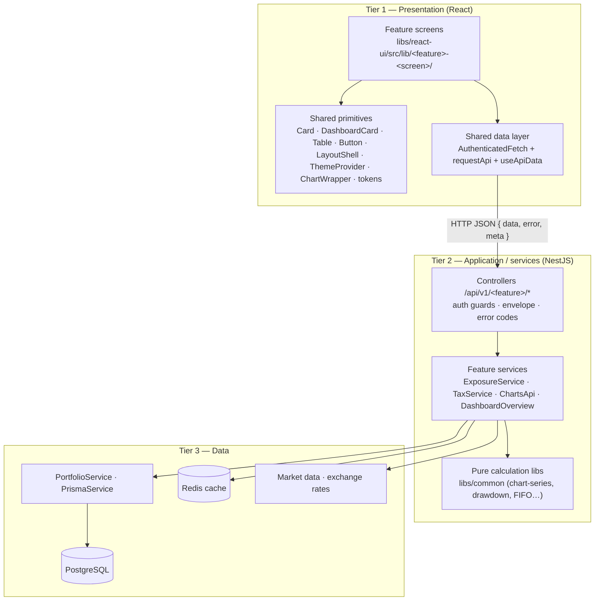

# Architecture — 3-tier / SOA (Iteration 3)

_Owner: Raniya Shaikh · Iteration 3, Week 1 (Nov 3–4, 2026)_

This is the reference architecture for Iteration 3. It extends the Iteration 2 backend ([architecture-as-built.md](../iteration-2/architecture-as-built.md)) with the React presentation tier and fixes where each feature's React entry points live. The original plan is in [target-architecture.md](../target-architecture.md); the shared library plan is in [react-migration-plan.md](../react-migration-plan.md).

Status labels: **Built** = on `main`; **Planned** = scheduled in the Iteration 3 sprint plan, with its issue.

## 1. The three tiers



| Tier                      | Lives in                                                         | Responsibility                                               | Must not                                                     |
| ------------------------- | ---------------------------------------------------------------- | ------------------------------------------------------------ | ------------------------------------------------------------ |
| 1. Presentation           | `libs/react-ui` (mounted in the Angular client, `apps/client`)   | Render screens, loading / error / empty states, user input   | Calculate financial values; call Prisma or services directly |
| 2. Application / services | `apps/api/src/app/<feature>/`, pure logic in `libs/common`       | HTTP contract, auth, validation, orchestration, calculations | Render UI; reach into another feature's internals            |
| 3. Data                   | `PortfolioService`, `PrismaService`, Redis, market-data services | Persistence, history, caching, external prices               | Contain feature business rules                               |

Each tier talks only to the one below it. The only path from React to the backend is HTTP through a feature controller.

## 2. Service boundaries (SOA)

Each feature is one service: one Nest module, one controller, its own JSON-schema contract under `contracts/`, and its own error-code prefix. Other services use it only through its exported Nest provider or its HTTP route.

| Service   | Owner  | Routes (`/api/v1`, all `portfolio:read`)                                          | Exports                        | Error prefix | Status                      |
| --------- | ------ | --------------------------------------------------------------------------------- | ------------------------------ | ------------ | --------------------------- |
| Risk      | Sesha  | `GET /risk/concentration`, `GET /risk/score` (#193), `POST /risk/what-if`         | `ExposureService`              | `RISK_`      | Built                       |
| Risk      | Sesha  | thresholds / warnings / target-allocation routes, catch-all envelope              | —                              | `RISK_`      | Planned (#24, Nov 11–12)    |
| Tax       | Tharun | `GET /tax/realized-gains`, `GET /tax/lots`                                        | `TaxDataService`, `TaxService` | `TAX_`       | Built                       |
| Tax       | Tharun | `GET /tax/dividends?year=YYYY` (#228)                                             | `TaxService`                   | `TAX_`       | Planned (PR #229 in review) |
| Charts    | Arthur | `GET /charts/series`, `GET /charts/drawdown`                                      | `ChartsApi`                    | `CHARTS_`    | Built                       |
| Charts    | Arthur | `GET /charts/benchmark-comparison` (#160), `GET /charts/return-comparison` (#105) | —                              | `CHARTS_`    | Planned (Week 3)            |
| Dashboard | Raniya | `GET /dashboard/overview`                                                         | `DashboardOverview`            | `DASHBOARD_` | Built                       |

Dependency direction is unchanged: Dashboard → Risk / Tax / Charts → Portfolio / Prisma. Only the dashboard composes other services; no other feature imports another feature's module.

## 3. Shared contracts across the tiers

- **Envelope.** Every response is `{ data, error, meta }` (`@ghostfolio/common/api-conventions`). On failure `data` is `null` and `error` is `{ code, message }` with the feature prefix. React reads `error.code`, never parses `message`.
- **Numbers.** Risk and charts send JSON numbers. Tax sends decimal amounts as strings; React keeps them as strings and only formats them for display (no `parseFloat` in calculations).
- **Dashboard sections.** `GET /dashboard/overview` returns each section as `{ status: 'available', data }` or `{ status: 'unavailable', error }`, so one failing service never breaks the page.
- **Authenticated fetch.** React code never reads tokens or the impersonation identity. Every hook takes the host's adapter:

  ```ts
  type AuthenticatedFetch = typeof fetch; // @ghostfolio/react-ui/data/api-request
  ```

  The Angular host builds it from its existing auth services (token, impersonation and timezone headers from `@ghostfolio/common/config`) and passes it down; tests pass a mock. `requestApi<T>(request, path, signal)` unwraps the envelope and throws `ApiRequestError { status, code }` without exposing server text. `useApiData(load, isEmpty)` returns a status that maps straight onto `DashboardCardStatus` (`loading` / `error` / `empty` / `ready`) plus `reload()`. The tax-lots hook (#195) follows the same pattern.

## 4. React entry points per feature

Feature screens follow a feature-first layout inside the shared library: one folder per screen, named `<feature>-<screen>`, next to the shared primitives. Shared primitives and the data layer stay with Raniya; feature folders belong to their owner.

| Feature   | Entry point (folder · component)                                                                                                         | Backend route(s)                                                | Issue                     | Status                            |
| --------- | ---------------------------------------------------------------------------------------------------------------------------------------- | --------------------------------------------------------------- | ------------------------- | --------------------------------- |
| Dashboard | `dashboard-page/` · `DashboardPage`                                                                                                      | `GET /dashboard/overview`                                       | #68                       | Planned (Thu–Fri Nov 5–6)         |
| Risk      | `risk-dashboard/` · `RiskDashboardCard`                                                                                                  | `GET /risk/score`, `GET /risk/concentration`                    | #26                       | Built (#211)                      |
| Risk      | `risk-indicator/` · `RiskIndicator`                                                                                                      | severity from the risk engine                                   | #188                      | Planned (Week 2)                  |
| Risk      | `risk-what-if/` · `WhatIfSimulator`                                                                                                      | `POST /risk/what-if`                                            | #187                      | Planned (Week 3)                  |
| Tax       | `tax-lots/` · `useTaxLots` hook, then tax-lot table with FIFO / average-cost selector                                                    | `GET /tax/lots`                                                 | #186, #194                | Hook built (#195); screen planned |
| Tax       | `tax-gains/`, `tax-summary/`, `tax-export/`                                                                                              | `GET /tax/realized-gains`, yearly summary, CSV / PDF export     | Tax Iteration 3 issues    | Planned (Weeks 2–3)               |
| Tax       | `dividend-withholding/` · `DividendWithholdingScreen`                                                                                    | `GET /tax/dividends?year=YYYY`                                  | #228, #230                | Planned (API #229, UI #231)       |
| Charts    | `chart-series/` · `useChartSeries` hook (#201, in review), then interactive chart on `ChartWrapper` with time-range selector and toggles | `GET /charts/series`                                            | Charts Iteration 3 issues | Planned (Weeks 1–2)               |
| Charts    | `charts-benchmark/`, `charts-return/`, `charts-waterfall/`, `charts-drawdown/`                                                           | benchmark, return comparison, waterfall, `GET /charts/drawdown` | Charts Iteration 3 issues | Planned (Weeks 3–4)               |

Shared, owned by Raniya (changes go through her PRs):

| Path                                                                                          | Contents                                                                       | Status       |
| --------------------------------------------------------------------------------------------- | ------------------------------------------------------------------------------ | ------------ |
| `card/`, `dashboard-card/`, `button/`, `layout-shell/`, `theme/`, `tokens/`, `chart-wrapper/` | UI primitives                                                                  | Built        |
| `table/`                                                                                      | `Table` for row data (lots, gains, holdings); renders decimal strings as given | Built (#208) |
| `data/`                                                                                       | `AuthenticatedFetch`, `requestApi`, `ApiRequestError`, `useApiData`            | Built (#208) |

Imports use the existing path alias `@ghostfolio/react-ui/<folder>/<file>` (for example `@ghostfolio/react-ui/card/card`).

## 5. Host integration

The Angular client (`apps/client`) stays the host. React screens are mounted into the portfolio area through a thin Angular host component that renders a React root and passes in the `AuthenticatedFetch` adapter built from the client's existing auth. No second authentication mechanism is introduced. The host is part of the Unified Dashboard work (#68); deployment of the combined build is planned for Week 2.

## 6. Request flow example

Loading the Unified Dashboard:

1. `DashboardPage` calls `request('/api/v1/dashboard/overview')` through the adapter from the host.
2. `DashboardController` checks login and `portfolio:read`, then calls `DashboardOverview.getOverview()`.
3. `DashboardOverview` loads risk (`ExposureService`), tax (`TaxService`) and charts (`ChartsApi`) in parallel; each reads history through `PortfolioService` / Prisma.
4. The response comes back in the envelope with one section per feature; `DashboardPage` renders each in its own `DashboardCard`, showing an error state only in a section that is `unavailable`.

## 7. Rules for Iteration 3 PRs

- A feature PR touches only its own `apps/api/src/app/<feature>/` and `libs/react-ui/src/lib/<feature>-*/` folders.
- Changes to shared primitives, the data layer, `api-conventions` or CI go through Raniya.
- A PR that adds or changes a route updates its contract schema and this document's tables (sections 2 and 4) in the same PR.
